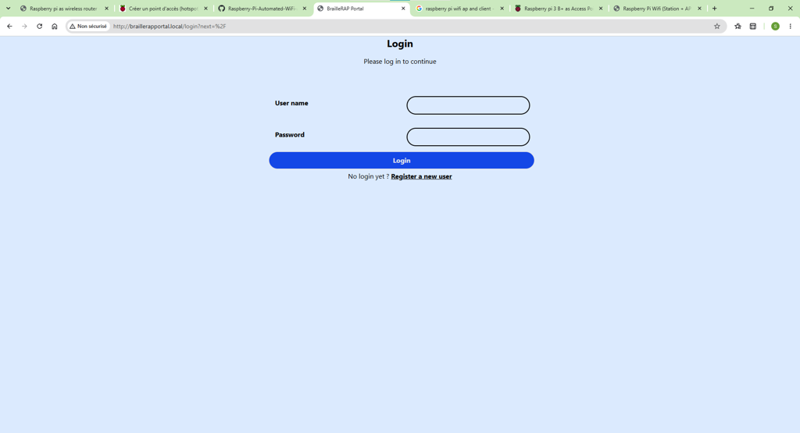

# Install on Raspberry Pi with existing WI-FI network.

## Select a Raspberry Pi.
Get an old one you have in a drawer for years. A Raspberry Pi 3 or a Raspberry Pi zero 2W are perfect, a Raspberry Pi 1 may  work.

## Install Raspberry Pi System.

### Select Debian Trixie Lite.
 You have some choice to install a Raspberry Pi OS, we recommend using Raspberry Pi Imager to install a headless Debian Trixie. Remind to use the **lite** version. If you need some details about 

### Mass Storage of SD Card.
 Select the Storage device to install the system.

### Enter hostname.
 We recommend to use **braillerapportal**. If you choose another hostname, you may have to customize some scripts.

### Select City, timezone and keyboard layout.

### Enter username.
 We recommend to use the user **braillerap**. If you choose another username, you may have to customize some scripts. Add a **strong password** you can remind easily.

### Activate SSH option.

### WI-FI.
 Enter the SSID and password of your WI-FI network to access internet from the Pi, and to access the BrailleRAP Portal from your network.

### Activate Raspberry Pi Connect only if you are used to.

### Confirm and write the SD Card.
You will need to expand the partition and update the system with **raspi-config** command

## Install BrailleRAPPortal on your Raspberry Pi.

Connect to the Pi

```bash
>ssh braillerap@braillerapportal.local
The authenticity of host 'braillerapportal.local (192.168.1.17)' can't be established.
ED25519 key fingerprint is SHA256:z/kPHDgEA0JZqIGnpx4dM/z15kmORfjsAunBrqi5RZU.
This key is not known by any other names.
Are you sure you want to continue connecting (yes/no/[fingerprint])? yes
Warning: Permanently added 'braillerapportal.local' (ED25519) to the list of known hosts.
braillerap@braillerapportal.local's password:
Linux braillerapportal 6.18.50+rpt-rpi-v8 #1 SMP PREEMPT Debian 1:6.18.50-1+rpt1 (2026-09-11) aarch64

The programs included with the Debian GNU/Linux system are free software;
the exact distribution terms for each program are described in the
individual files in /usr/share/doc/*/copyright.

Debian GNU/Linux comes with ABSOLUTELY NO WARRANTY, to the extent
permitted by applicable law.
```
Expand the filesystem

```bash
>sudo raspi-config
```
expand the file system with menu **Advanced Option / Expand filesystem**

reboot the Raspberry Pi after expanding the filesystem.
```bash
>sudo reboot
```
## Download the package portal.zip

```bash
  wget https://github.com/braillerap/BrailleRAPPortal/releases/download/latest/portal.zip
```

## Unzip the package

```bash
unzip portal.zip
```

## Change current directory

```bash
cd portal
```
## Install python dependencies in a virtual env

```bash
>python -m venv venv
>source ./venv/bin/activate
>pip install -r requirements.311.txt
```
## Create a secret key for the application
```bash
echo "SECRET_KEY=\"$(openssl rand -hex 16)\"" > .env
```
## Install the web app as system service

### Install nginx
 ```bash
 sudo apt update
 sudo apt install nginx
 ```
### Enable BrailleRAP portal as a service
 ```bash
 sudo cp ./install/braillerap.service /etc/systemd/service/
 sudo systemctl enable braillerap
 ```

### Start the application
 ```bash
 sudo systemctl start braillerap
 ```
### nginx config

 Remove the default web site
 ```bash
 sudo rm /etc/nginx/sites-enabled
 ```
 
  Make the BrailleRAP Portal app available as web site
  ```bash
  sudo cp ./install/braillerap.nginx /etc/nginx/sites-available/braillerap
  sudo ln -s /etc/nginx/sites-available/braillerap /etc/nginx/sites-enabled/braillerap
  ```

  Restart nginx
  ```bash
  sudo systemctl restart nginx
  ```
## Enjoy the portal
With a web browser nagivate to the url [http://braillerapportal.local](http://braillerapportal.local)

